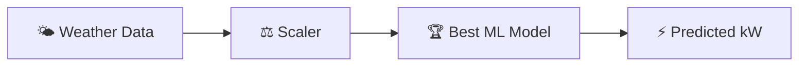

<div align="center">


<b><i>Forecast solar power generation with ML</i></b>


       

   
</div>

---

## ☀️ About the Project

Predicts **solar power generation** from weather and environmental conditions (irradiance, temperature, humidity, wind, cloud cover...) using machine learning, presented in an interactive **Flask dashboard** with a database-backed prediction history.

## ✨ Key Features

- 🌤️ Weather-based **solar output prediction**
- 🏆 Best model auto-selected (`best_model.pkl`) with feature scaling
- 🗄️ Prediction storage in **SQLite** (`solar_energy.db`)
- 📊 Interactive UI with modals & charts
- 📚 Quick-start, setup checklist and troubleshooting guides

## 🧠 How It Works



## 🛠️ Tech Stack

| Layer | Technology |
|---|---|
| Language | Python 3 |
| Data & ML | Pandas · NumPy · scikit-learn |
| Notebook | Jupyter |
| Web App | Flask + Jinja2 templates |
| Frontend | HTML5 · CSS3 |
| Database | SQLite |
| Config | .env · config.py |

## 📂 Project Structure

```text
SOLAR ENEGY PREDICTION/
├── run.py · app.py · config.py · models.py · init_db.py
├── model.py · generate_dataset.py
├── best_model.pkl · scaler.pkl
├── solar_dataset.csv · spg.csv
├── static/ (css, js) · templates/
└── QUICKSTART.md · SETUP_CHECKLIST.md · TROUBLESHOOTING.md
```

## 🚀 Getting Started

```bash
git clone https://github.com/PreciousBharath/SOLAR-ENERGY-PREDICTION.git
cd "SOLAR-ENERGY-PREDICTION/SOLAR ENEGY PREDICTION"
pip install -r requirements.txt
cp .env.example .env
python init_db.py
python run.py
```

> 💡 See `SOLAR ENEGY PREDICTION/QUICKSTART.md` for full setup details.

## 🤝 Contributing

Contributions, issues and feature requests are welcome! Feel free to ⭐ star the repo and open a pull request.

## 👨‍💻 Author

<div align="center">

**Bharath** — Software Developer · Project Engineer · Technical Trainer

<a href="https://github.com/PreciousBharath"></a>
<a href="https://linkedin.com/in/connectbharath"></a>

### 🍔 EAT · 💻 CODE · 😴 SLEEP · 🔁 REPEAT

⭐ **If you found this project useful, give it a star!** ⭐


</div>
